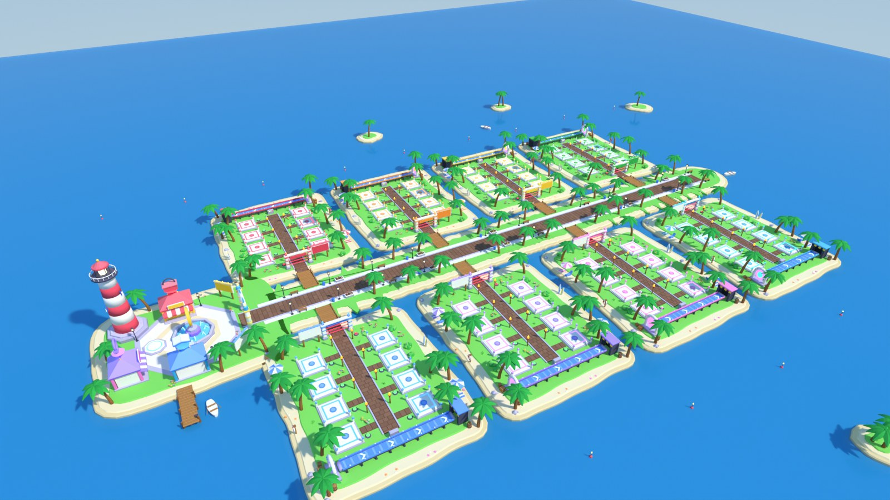
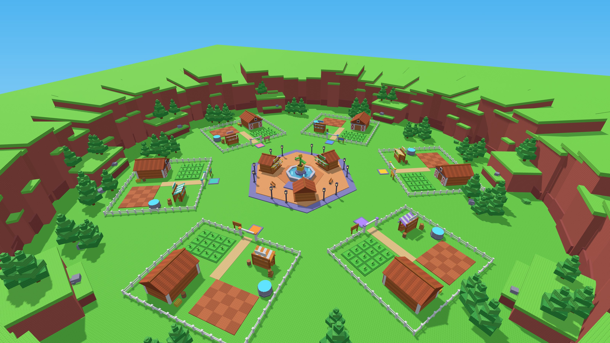
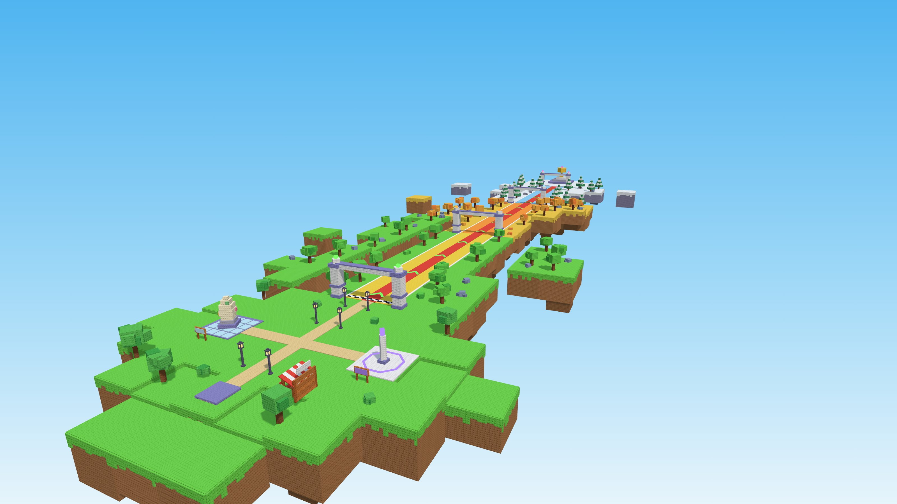
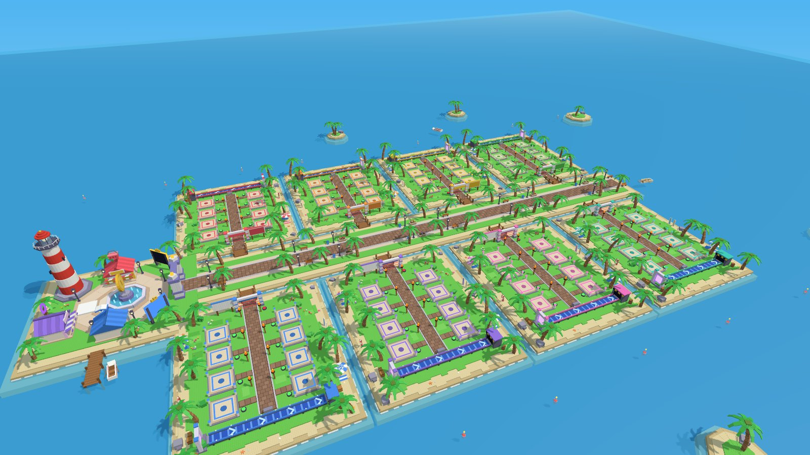

# Games: Roblox stud-style maps

Three original Roblox maps built from plain Parts by a small Python generator (`studmap`), each with preview renders.

| Map | Style | Parts | File |
|---|---|---|---|
| **Harvest Hollow**: 6 fenced farm plots round a hex market plaza in a canyon bowl | studs | 3,597 | `out/harvest_hollow/HarvestHollow.rbxmx` |
| **Sky Sprint**: floating islands with a hub and a long runway through Meadow, Golden Fields and Frost zones | studs | 2,881 | `out/sky_sprint/SkySprint.rbxmx` |
| **Plot Isles**: 8 identical plot islands on a main road in a see-through tropical sea. Each plot has a laser-lock gate, an owner board, 8 pedestal pads with collect buttons, a conveyor with a spawn portal and exit tunnel, tiki torches, palms and beach props. The spawn hub has a lighthouse, coin fountain, Shop / Index / Rebirth huts and leaderboards | studs + smooth props | 14,659 | `out/plot_isles/PlotIsles.rbxmx` |

### Plot Isles, Blender version

The same Plot Isles layout, modelled in Blender: bevelled meshes, rounded sandy islands, curved palms and hip-roof huts.
It is exported as 96 prop models plus 4 ground pieces, with a generated setup script that places 890 props. It has
404,844 triangles and passed the exporter's budget, clipping, floating, water and collision checks. To import it, see
[`out/plot_isles_blender/SETUP.md`](out/plot_isles_blender/SETUP.md).



The scripts that build this version are not in this repo: they use a privately licensed Blender skill. Only the
generated maps, models and scripts are here.





More views of each map are in `out/<map>/previews/`.

## Put a map in Roblox Studio

1. Download the map's `.rbxmx` file.
2. In Studio, right-click **Workspace** in the Explorer, choose **Insert from File...**, and pick the file.
   The map arrives as one Model with Folders (Ground / Canyon / Plaza / Plots / Nature, and so on). Every Part is
   Anchored, and each map includes a SpawnLocation.
3. Optional bright-daylight look: paste this into the command bar:

```lua
local L = game:GetService("Lighting")
L.ClockTime = 14
L.Brightness = 2.5
L.Ambient = Color3.fromRGB(110, 110, 120)
L.OutdoorAmbient = Color3.fromRGB(160, 160, 165)
L.GlobalShadows = true
L.EnvironmentDiffuseScale = 0.6
L.EnvironmentSpecularScale = 0.2
```

Stud parts use Plastic with the **Studs** surface on every face; round and organic props (palms, flowers, boats) use SmoothPlastic. Signs are blank boards,
so add text with a SurfaceGui. Each map is Parts only: no meshes, no uploads and no asset ids.

The files have not been opened in Studio yet; they were checked by parsing the XML and validating every Part
(orthonormal rotation, size 0.05 to 2,048 studs).

## Rebuild or change a map

Needs Python 3 and, for previews, Node with Playwright.

```bash
python3 tools/build.py harvest_hollow            # writes out/harvest_hollow/HarvestHollow.rbxmx
cd preview && npm install && cd ..               # once, for previews
python3 tools/build.py harvest_hollow --render   # also renders out/harvest_hollow/previews/*.jpg
```

- `maps/<name>.py`: one file per map (layout, colours, props, camera views). Roblox space: X east, Y up, Z south, 1 unit = 1 stud,
  and the front of every prop is -Z.
- `studmap/core.py`: Parts, CFrames, props (`box`, `span`, `wedge`, `cyl`, `ball`, flat `poly` made of wedges).
- `studmap/kit.py`: reusable props (pine, leafy tree, bush, rock, fence, barn, stall, roof, lamp, arch and others).
- `studmap/islands.py`: floating grid islands with grass drips.
- `studmap/export.py`: `.rbxmx` writer + preview JSON.
- `preview/`: three.js viewer and the Playwright screenshot renderer.
